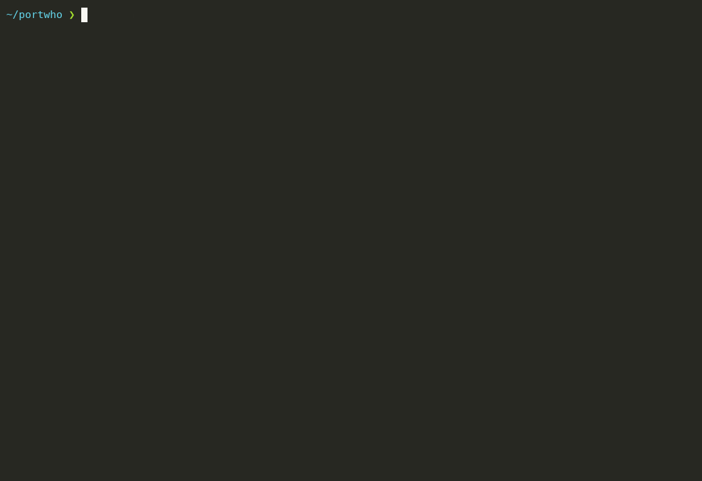

<p align="center">
  
</p>

<h1 align="center">skills</h1>

<p align="center"><b>Skills for coding agents: launch-ready repos and Napkin-style books.</b></p>

<p align="center">
  <a href="https://github.com/andrewboldi/skills/actions/workflows/test.yml"></a>
  <a href="LICENSE"></a>
  <a href="https://agentskills.io"></a>
</p>

<p align="center">
  <a href="#the-skills">Skills</a> ·
  <a href="#install">Install</a> ·
  <a href="#how-it-works">How it works</a> ·
  <a href="docs/caveats.md">Caveats</a> ·
  <a href="CONTRIBUTING.md">Contributing</a>
</p>

Ever asked a coding agent to get a project ready to share, and got back a 400-line README with
a list of requirements? These skills give Claude Code, Codex, opencode and other agents a tested
method for three jobs:
- getting a repo ready for a Show HN launch;
- writing a book-length guide to any topic in the style of Evan Chen's Napkin;
- running GPU jobs on Google Colab without wasting compute units.

<p align="center">
  
</p>

## The skills

**[hn-ready](skills/hn-ready/SKILL.md)** gets a project ready for a Show HN launch.
- **It audits, then asks.** It checks the repo against a launch checklist and hands back numbered
  proposals. Nothing changes until you pick.
- **It covers what a launch needs:**
  - one command that installs everything
  - a README of about 80 lines
  - a logo checked on light and dark backgrounds
  - a real demo GIF, every frame checked for anything personal
  - CI, and a privacy sweep of the git history
- **It hands over a Show HN kit, not a post.** You get a title, a pre-filled submit link, talking
  points and posting times from 73,000 Show HN posts. You write the post yourself: HN's
  moderators don't want LLM-written comments.

**[writing-napkin-books](skills/writing-napkin-books/SKILL.md)** writes a book that teaches a
field in one PDF, in the style of Evan Chen's *An Infinitely Large Napkin*.
- **A reading guide, a crash course from zero, or both,** optionally followed by the cited arXiv
  papers bound into one linked volume.
- **Writers draft and separate agents fact-check** against primary sources. Every claim has a
  source the reader could open, and every number is recomputed.
- **A LaTeX template and checks.** `tools/check.sh` builds the book and fails on unresolved
  citations, broken references and unwritten sections.

**[colab-browser](skills/colab-browser/SKILL.md)** runs GPU jobs on Google Colab with Google's
official `colab` CLI, and falls back to a real browser you sign in to for notebooks and Drive.
- **Jobs that look after themselves.** A small runner inside the VM streams the job's log, writes a
  heartbeat with GPU use, stops at a deadline, and releases the runtime when the job is done, even if
  the agent is gone.
- **No wasted compute units.**
  - A watch script reports finished, quiet and lost jobs, and stops sessions that sit idle.
  - It never touches runtimes it didn't start.
  - It checks the job's own evidence before stopping anything that is running.
- **Sign-in on your terms.** The agent never opens your everyday browser. It clicks a sign-in or
  consent screen only when you've given a standing permission for that screen, matches the screen
  exactly, and logs every click.
- **The traps, measured:**
  - `colab status` reports the CLI's own record, not the VM;
  - `colab upload` fails on large files;
  - a killed `colab run` leaves the VM billing;
  - Drive lags and caches files;
  - settings get sized for the wrong GPU;
  - rendering runs on the CPU.

## Install

```sh
curl -fsSL https://raw.githubusercontent.com/andrewboldi/skills/main/install.sh | bash
```

It copies the skills into every coding agent it finds: Claude Code, Codex, opencode, Gemini CLI,
Cursor, GitHub Copilot and pi. Run it again to update. Add `-s -- --uninstall` after `bash` to
remove them. Rather use Claude Code's plugin installer, or install only one skill?
[Install by hand](docs/install-manually.md).

## How it works

A skill is a folder with a `SKILL.md`. When your request matches its description, the agent
reads it and follows it. It reads the reference files and scripts beside it only when a step
needs them. Each skill here was tested the same way. A fresh agent got a task the skill covers on
a throwaway project, and every place it went wrong became a fix in the skill.
[How to test a skill](CONTRIBUTING.md#test-a-skill).

## Contributing

Work is tracked with [bd](https://github.com/steveyegge/beads), and that's required: every
change starts as a bd issue. Most contributions come through a coding agent anyway, and bd gives
the agent and the maintainers the same list of open work. See [CONTRIBUTING.md](CONTRIBUTING.md).

## License

MIT.
